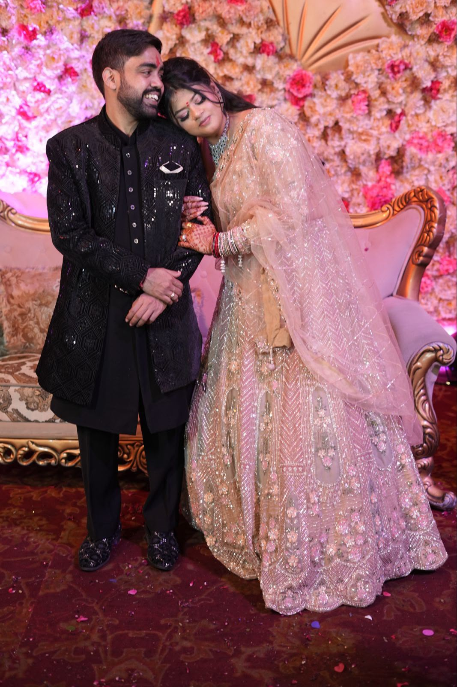

  

<h1 align="center">✨ Manisha & Gagan ✨</h1>
<h3 align="center">~ A Love Written in the Stars ~</h3>

  
  
  

---

<i>"A lifetime of togetherness begins with one sacred step."</i>

---

## 🌸 What Is This?

A **beautiful, interactive digital wedding invitation** — designed to be shared via WhatsApp, Instagram, or any link. No apps to install, no accounts to create. Just open and experience the magic.

## 💫 The Experience

| Step | What Happens |
|:---:|---|
| 🎬 | **Portal Video** — A cinematic intro video plays fullscreen when you tap |
| 🎵 | **Background Music** — Soft wedding music begins playing instantly |
| ✨ | **Bright Flash** — A magical transition reveals the invitation |
| 🕉️ | **Sacred Blessings** — Opens with Ganesh Vandana and family blessings |
| 💕 | **Couple Names** — Manisha & Gagan in shimmering gold gradient |
| 🗓️ | **Scratch to Reveal** — Guests scratch cards to discover the wedding date |
| ⏳ | **Live Countdown** — Real-time countdown to the ceremony |
| 📸 | **Our Story** — A polaroid-style photo gallery of memories |
| 🏛️ | **The Venue** — Sahib Farms & Resorts with Google Maps link |
| 🎉 | **Festivities** — Haldi, Sangeet Night & Sun Downer Wedding with dress codes |
| 💌 | **RSVP** — Guests confirm attendance, pick events, request a song & share advice |
| 📞 | **Contacts** — Groom's & Bride's family numbers |
| 🌺 | **Falling Petals** — Ambient rose petals floating across the screen |

## 🎨 Three Beautiful Events

<table>
<tr>
<td align="center" width="33%">

### 🌼 Haldi Ceremony
**19 Nov · 12:00 PM**

*"A joyful splash of turmeric, blessings, and laughter."*

🟡 Yellow · 🩷 Pink · 🍑 Peach

</td>
<td align="center" width="33%">

### 🎶 Sangeet Night
**19 Nov · 7:00 PM**

*"An evening of music, dance, and endless celebration."*

🔵 Blue · ⚫ Black · 🟢 Dark Green

</td>
<td align="center" width="33%">

### 💒 Sun Downer Wedding
**20 Nov · 3:00 PM**

*"Vows beneath the setting sun to begin our forever."*

🟤 Maroon · 🤍 Ivory · 🥇 Gold

</td>
</tr>
</table>

## 🗣️ Bilingual — English & हिंदी

Toggle between **English** and **Hindi** with a single tap. Every piece of text — from the blessings to the RSVP form — is fully translated.

## 💌 RSVP → Google Sheets

Guests fill out a beautiful form with:
- ✅ Name & Phone
- 🎉 Joyfully Accept / Regrettably Decline
- 👥 Party Size
- 🎪 Which events they'll attend
- 🎵 A song request for the dance floor
- 💬 Marriage advice

All responses flow directly into a **Google Sheet** — no database needed.

## 🛠️ Built With Love

> Pure **HTML**, **CSS** & **vanilla JavaScript** — no frameworks, no build tools, no complexity. Just open and it works.

---

  <b>🕊️ With love and blessings 🕊️</b> 
  <i>The Lovely People's</i>  
  <b>Manisha & Gagan</b>

